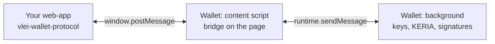
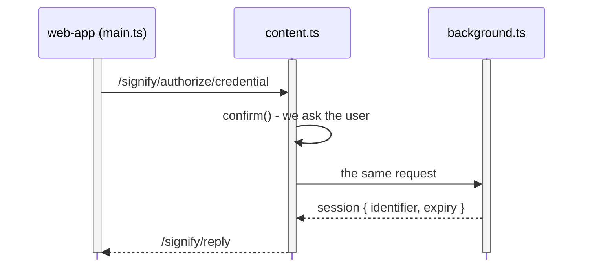

# vLEI Wallet Protocol

**Sign-in with vLEI instead of a login and password — for any web-app and any wallet in the browser.**

[TOC]

---

<a id="what"></a>
## What it is and why

vLEI is a verifiable digital credential of a company and of the people who act on its behalf. It is kept in a
wallet - a browser extension. **`vlei-wallet-protocol`** is a common language in which any web-app talks to
any such wallet, and a library that implements both sides.

**Example.** You are a supplier, and you have a portal for client companies. You need to know for sure that an
order is placed by exactly this company and exactly its representative, not by someone who guessed a password.
With the protocol, the client does not create a login and password with you: they click "Sign in", choose their
vLEI in the wallet - and you get a verifiable answer about who they are and which company they are from. After
that, the wallet signs every important request (an order, a document signature) with the client's key, and your
server verifies the signature.

**Who does what**

- **Web-app** - your site. Anyone can write it: a team, a freelancer, or you yourself together with an AI assistant.
- **Wallet (browser extension)** - keeps the keys and the vLEI, asks the user "allow?". Anyone can write it too;
  the reference wallet is [vLEI Wallet](https://github.com/GLEIF-IT/signify-browser-extension).
- **Protocol** - the agreement between them. A site written once works with any compatible wallet, and a new
  wallet works with all such sites right away. That is how the network grows.



**What you can do from the site**

| I want to | Function |
|---|---|
| Find out whether the user has a wallet | `isExtensionInstalled()` |
| Sign in with vLEI | `connectIdentity()` |
| Not ask to sign in again after a reload | `restoreSession()` |
| Switch the user | `switchIdentity()` |
| Sign an HTTP request to my server | `signRequest(url, method)` |
| Sign arbitrary data | `createClient().signData({ items })` |
| Issue a credential | `issueCredentials([...])` |

:::info
Keys never leave the wallet. The site gets only the result: who signed in, signatures, and issued credentials.
:::

:::spoiler Glossary
- **AID** - an identifier of a person or an organization in KERI (something like a public key with a history).
- **Credential (ACDC)** - a signed credential, for example a vLEI. Each one has a schema (what is inside) and a holder (an AID).
- **SAID** - a short fingerprint of data; schemas and credentials are referenced by it.
- **KERIA** - a server agent with which the wallet keeps and updates the state of its keys.
- **Session** - "this tab and this site are signed in under this AID" until the moment of `expiry`.
:::

---

<a id="web-app"></a>
## Web-app: quick start

**You need:** Node.js 20.19+, git and Chrome.

Create a folder and put three files in it.

`package.json`

```json
{
  "name": "vlei-web-app",
  "private": true,
  "type": "module",
  "scripts": {
    "dev": "vite --port 5173"
  },
  "dependencies": {
    "vlei-wallet-protocol": "github:vladislavpopovwork/vlei-wallet-protocol#v0.1.0"
  },
  "devDependencies": {
    "vite": "^7.0.0"
  }
}
```

- `vlei-wallet-protocol` - the library. It is not in the npm registry: npm downloads it from git by the tag `v0.1.0` and builds it itself.
- `vite` - a dev server: serves the page and loads npm packages in the browser.

`index.html` - an ordinary page: a status, two buttons and a place for the reply.

```html
<!doctype html>
<html lang="en">
  <head>
    <meta charset="utf-8" />
    <title>vLEI web-app</title>
  </head>
  <body>
    <p id="status">Looking for the extension…</p>
    <button id="login">Sign in</button>
    <button id="sign">Sign request</button>
    <pre id="out"></pre>
    <script type="module" src="./main.ts"></script>
  </body>
</html>
```

`main.ts` - the whole integration.

```ts
import { isExtensionInstalled, restoreSession, connectIdentity, signRequest } from "vlei-wallet-protocol";

const status = document.getElementById("status")!;
const out = document.getElementById("out")!;
const show = (value: unknown) => (out.textContent = JSON.stringify(value, null, 2));
const showError = (error: unknown) => (out.textContent = `Error: ${(error as Error).message}`);

// 1. Is there a vLEI wallet in the browser? And has the user already signed in on this tab?
isExtensionInstalled().then(async (extensionId) => {
  if (!extensionId) return (status.textContent = "Extension not found");
  status.textContent = `Found extension ${extensionId}`;
  const session = await restoreSession();
  if (session) {
    status.textContent = "Already signed in";
    show(session);
  }
});

// 2. Sign-in: the wallet asks the user which vLEI to present.
document.getElementById("login")!.onclick = () =>
  connectIdentity({ message: "Sign in to the demo app" })
    .then((auth) => {
      status.textContent = "Signed in";
      show(auth);
    })
    .catch(showError);

// 3. Signed request: the wallet signs it with the user's key, your server verifies the signature.
document.getElementById("sign")!.onclick = () => signRequest(location.href, "GET").then(show).catch(showError);
```

Run:

```bash
npm install
```

```bash
npm run dev
```

Open http://localhost:5173.

- **No wallet** - after 3 seconds the status is "Extension not found". That is fine: a wallet is built in a minute
  in the [next section](#extension).
- **There is a wallet** - "Found extension …", the buttons work. What exactly happens is in the section ["All together"](#together).

**What happens here**

- `isExtensionInstalled()` - the page asks "is there a wallet here?", the wallet answers with its ID.
- `connectIdentity()` - the wallet shows a sign-in window. The result is who signed in: `credential` (the chosen vLEI)
  and/or `identifier.prefix` (the user's AID), plus `expiry` (until what moment the session lasts).
  What exactly arrives depends on the wallet, so the example just shows the whole reply.
- `signRequest(url, method)` - returns headers with a signature. Send the request with exactly these headers:
  `fetch(url, { headers: await signRequest(url, "GET") })`, and the server verifies the signature by the AID.
- If the user refused or there is no session, the function throws an error - hence `.catch` everywhere.

All functions and their errors are in [PROTOCOL_DEMO.md, section 2](https://github.com/vladislavpopovwork/vlei-wallet-protocol/blob/main/PROTOCOL_DEMO.md#2-wallet-functions).

---

<a id="extension"></a>
## Your own wallet: browser extension

You need this section if you are writing your own wallet or adding the protocol to your extension. If you are
building only a site - take the ready vLEI Wallet and go to the section ["All together"](#together).

:::warning
**This is a demo wallet.** It has a fake AID, no keys, and it signs nothing. On the other hand, you need no Docker,
KERIA or vLEI: in a minute your web-app will find the extension and sign in through it.
:::

The extension consists of two parts:

- **content script** (`content.ts`) - runs inside the page. It is a bridge: it answers the site "I am here",
  shows the sign-in confirmation and passes the other requests to background. `createContentBridge` does all of this.
- **background** (`background.ts`) - the extension's service worker. The logic is here: sessions (and in a real
  wallet - keys and the connection to KERIA). `createBackgroundRouter` - one handler per message type.

Create a folder and put four files in it.

`package.json`

```json
{
  "name": "vlei-demo-extension",
  "private": true,
  "scripts": {
    "build": "esbuild content.ts background.ts manifest.json --bundle --outdir=dist --loader:.json=copy"
  },
  "dependencies": {
    "vlei-wallet-protocol": "github:vladislavpopovwork/vlei-wallet-protocol#v0.1.0"
  },
  "devDependencies": {
    "@types/chrome": "^0.1.0",
    "esbuild": "^0.25.0"
  }
}
```

`manifest.json` - the extension's passport for Chrome.

```json
{
  "manifest_version": 3,
  "name": "vLEI Demo Wallet",
  "version": "0.1.0",
  "background": { "service_worker": "background.js" },
  "content_scripts": [
    {
      "matches": ["http://localhost/*"],
      "js": ["content.js"],
      "run_at": "document_end"
    }
  ]
}
```

- `matches` - on which sites the wallet is available. For the demo - only `localhost` (any port); a real wallet
  adds `https://*/*`.

`content.ts`

```ts
import {
  createContentBridge,
  forwardViaRuntime,
  HandlerError,
  PROTOCOL_ERRORS,
  type AuthorizeResult,
} from "vlei-wallet-protocol/extension";

// Passes a page request to background.ts and returns its reply.
const forward = forwardViaRuntime((envelope) => chrome.runtime.sendMessage(envelope));

createContentBridge({
  extensionId: chrome.runtime.id,
  forward,
  local: {
    // We ask about the sign-in right on the page, and background creates the session.
    "/signify/authorize/credential": async (request) => {
      if (!confirm(`Demo wallet: sign in to ${location.origin}?\n\n${request.payload?.message ?? ""}`)) {
        throw new HandlerError(PROTOCOL_ERRORS.cancelled);
      }
      return (await forward(request)) as AuthorizeResult;
    },
  },
});
```

- `local` - requests that are handled right on the page. Here it is only the sign-in: `connectIdentity()` on the
  site sends `/signify/authorize/credential`. Instead of `confirm()`, a real wallet shows a window with a list of vLEIs.
- `HandlerError(PROTOCOL_ERRORS.cancelled)` - the standard reply "the user refused". The site gets the error
  `request has been cancelled`.

`background.ts`

```ts
import {
  createBackgroundRouter,
  createRuntimeListener,
  HandlerError,
  PROTOCOL_ERRORS,
  type AuthorizeResult,
} from "vlei-wallet-protocol/extension";

// Not a real identifier: the demo wallet keeps no keys and signs nothing.
const DEMO_AID = "EDemo_not_a_real_identifier";

// Sessions per tab and site. They live in memory while the service worker runs.
const sessions = new Map<string, AuthorizeResult>();

const router = createBackgroundRouter({
  "/signify/authorize/credential": (_request, { tabId, origin }) => {
    const session = { identifier: { prefix: DEMO_AID, name: "demo" }, expiry: Date.now() + 30 * 60_000 };
    sessions.set(`${tabId} ${origin}`, session);
    return session;
  },
  "/signify/get-session-info": (_request, { tabId, origin }) => {
    const session = sessions.get(`${tabId} ${origin}`);
    if (!session) throw new HandlerError(PROTOCOL_ERRORS.sessionNotFound);
    return session;
  },
});

// Accepts requests from content.ts. Other message types get the reply "Unsupported message type".
const listener = createRuntimeListener(router, chrome.runtime.id, { requireActiveTab: true });
chrome.runtime.onMessage.addListener((message, sender, sendResponse) => {
  const response = listener(message, sender);
  if (!response) return false;
  response.then(sendResponse);
  return true; // the reply arrives asynchronously
});
```

- The library takes `tabId` and `origin` from the browser, not from the message: a site cannot pass itself off as another site.
- `get-session-info` - `restoreSession()` on the site calls it after the page is reloaded.
- All unsupported requests are rejected. You cannot sign a request with the demo wallet - it simply has no KERIA to sign with, and you get the error `Unsupported message type`.
- `requireActiveTab` - requests from background tabs are rejected.

Build:

```bash
npm install
```

```bash
npm run build
```

Install in Chrome:

1. Open `chrome://extensions`.
2. Turn on **Developer mode** (top right).
3. **Load unpacked** → choose the `dist` folder.
4. Reload the tab with the web-app.

Next - ["All together"](#together).

**How to turn the demo into a real wallet**

:::warning
The table below is the whole path from the demo wallet to your own full wallet, step by step. Go through it if you
want to understand more deeply how a wallet works, or to write your own from scratch. If you only need to add a
couple of your own features, take the ready [vLEI Wallet](https://github.com/GLEIF-IT/signify-browser-extension) as a base.
:::

The demo differs from a real wallet in three things: keys and signatures (KERIA), the sign-in window and the set
of supported messages. For each there is ready code - take it from there.

| What to add | Where | What to look for there |
|---|---|---|
| Connection to KERIA | vLEI Wallet: [`src/pages/background/services/signify-connection.ts`](https://github.com/GLEIF-IT/signify-browser-extension/blob/main/src/pages/background/services/signify-connection.ts) | How background creates a `SignifyClient`, connects to the agent by passcode (`connect`, `bootAndConnect`) and disconnects on timeout. |
| Real signatures and sessions | vLEI Wallet: [`src/pages/background/services/signify-operations.ts`](https://github.com/GLEIF-IT/signify-browser-extension/blob/main/src/pages/background/services/signify-operations.ts) | What the router handlers call: `authorizeSelectedSignin` (sign-in reply and session), `getSessionInfo`, `getSignedHeaders` (request signature), `signData`, `getCredential`. These replace the handlers of the demo `background.ts`. |
| Credential issuance | vLEI Wallet: [`src/pages/background/services/credential-issuance.ts`](https://github.com/GLEIF-IT/signify-browser-extension/blob/main/src/pages/background/services/credential-issuance.ts) | `issueBatch`: request validation, the registry, issuance one by one and the list of the already issued ones on error (`issued`). |
| A sign-in window instead of `confirm()` | vLEI Wallet: [`src/pages/content/index.tsx`](https://github.com/GLEIF-IT/signify-browser-extension/blob/main/src/pages/content/index.tsx) | `createContentBridge` with `local` handlers for `authorize*`: show a window with a list of sign-ins, wait for a choice or a refusal (`PROTOCOL_ERRORS.cancelled`). |
| All messages in a working wallet | vLEI Wallet: [`src/pages/background/handlers/protocol.ts`](https://github.com/GLEIF-IT/signify-browser-extension/blob/main/src/pages/background/handlers/protocol.ts) | `createBackgroundRouter` for all message types: sessions, signatures, credential issuance with confirmation in the extension window, vendor configuration. |
| Check that nothing is forgotten | [PROTOCOL_DEMO.md, section 6](https://github.com/vladislavpopovwork/vlei-wallet-protocol/blob/main/PROTOCOL_DEMO.md#6-implementing-an-extension) | The checklist at the end of the section: the handshake with the site, one reply per request, errors, windows, keys do not reach the page. |
| Your own message types | [README: Extending the protocol](https://github.com/vladislavpopovwork/vlei-wallet-protocol#extending-the-protocol) | How to declare a new message once so that both the site and the wallet see its types. |

In a real wallet, keep sessions in `chrome.storage.session`, not in a `Map`: Chrome puts the service worker to sleep,
and the data in memory is lost.

---

<a id="together"></a>
## All together: web-app + wallet

We take the [web-app](#web-app) and the [demo wallet](#extension) from the sections above without changes. There is
no new code - only running it.

1. The demo wallet is built and loaded (**Load unpacked** → `dist`).
2. In the web-app folder: `npm run dev`, open http://localhost:5173.
3. Status: **"Found extension …"** - the site and the wallet have recognized each other.
4. **"Sign in"** → the window "Demo wallet: sign in to http://localhost:5173?" → **OK** → **"Signed in"**, below it - the
   wallet's reply with `"prefix": "EDemo_not_a_real_identifier"`. If you click "Cancel" - "Error: request has been cancelled".
5. Reload the page → **"Already signed in"**: the session was restored without signing in again.
6. **"Sign request"** → **"Error: Unsupported message type: /signify/sign-request"**. The demo wallet cannot
   sign and honestly says so.

What happens at sign-in:



<a id="vlei-wallet"></a>
### Replacing it with the real vLEI Wallet

The same web-app from the example

1. In `chrome://extensions` turn off **vLEI Demo Wallet**. Keep only one wallet turned on - otherwise whichever
   is faster will answer.
2. Build and load the vLEI Wallet:

   ```bash
   git clone https://github.com/GLEIF-IT/signify-browser-extension.git
   ```

   ```bash
   cd signify-browser-extension && npm install && npm run build
   ```

   **Load unpacked** → the `dist/chrome` folder.
3. Open the wallet (the icon on the toolbar, top right): in the settings set **Agent Url** and **Boot Url** of your KERIA
   (locally usually `http://localhost:3901` and `http://localhost:3903`), then enter the passcode and click **Connect**.
   The agent must have at least one credential - `connectIdentity()` signs in with a credential.
4. Reload the tab http://localhost:5173 and click **"Sign in"**:
   - the first time, the wallet asks you to open it: the icon on the toolbar, top right → **Credentials** → **Select** on the credential you need;
   - on the page, choose the sign-in that appeared and click **Sign in with Credential** → **"Signed in"**.

   Next time you do not need to open the wallet: the chosen credential is saved as the sign-in for this site
   (the **Sign Ins** tab in the wallet, **Delete** is there too). On the page you only need to choose it and click
   **Sign in with Credential** - the wallet asks to confirm the sign-in every time.

The difference

| Request | Demo wallet | vLEI Wallet |
|---|---|---|
| Authorization | mock `confirm()` | a window on the page with a list of credentials |
| Sign-in reply | `identifier` (demo AID), `expiry` | `credential` (`raw`, `cesr`), `expiry` |
| "Sign request" | `Unsupported message type` | headers `signature`, `signature-input`, `signify-resource`, `signify-timestamp` |

We replaced the mock wallet with the real vLEI Wallet. Nothing had to change in the code, because both wallets speak
the same protocol: the same handshake with the site, the same message types and errors, and both work on `http://localhost/*`.

---

<a id="next"></a>
## Where to go next

| Topic | Where |
|---|---|
| All messages, their fields and replies | [PROTOCOL_DEMO.md, section 3](https://github.com/vladislavpopovwork/vlei-wallet-protocol/blob/main/PROTOCOL_DEMO.md#3-client-api-and-messages) |
| How messages travel between the site and the wallet | [PROTOCOL_DEMO.md, section 4](https://github.com/vladislavpopovwork/vlei-wallet-protocol/blob/main/PROTOCOL_DEMO.md#4-transport-and-handshake) |
| Errors | [PROTOCOL_DEMO.md, section 5](https://github.com/vladislavpopovwork/vlei-wallet-protocol/blob/main/PROTOCOL_DEMO.md#5-errors) |
| TypeScript types | [PROTOCOL_DEMO.md, section 8](https://github.com/vladislavpopovwork/vlei-wallet-protocol/blob/main/PROTOCOL_DEMO.md#8-types) |
| Installation, credential issuance, tests | [README](https://github.com/vladislavpopovwork/vlei-wallet-protocol#readme) |
| Ready files of the examples from this page | [`docs/examples`](https://github.com/vladislavpopovwork/vlei-wallet-protocol/tree/main/docs/examples) |
| The original protocol this one is based on | [polaris-web](https://github.com/WebOfTrust/polaris-web) |

<a id="troubleshooting"></a>
## If something does not work

- **"Extension not found"** - reload the tab after installing the wallet. The page address must match the
  wallet's `matches` (for the demo - only `http://localhost`).
- **`Session not found`** - nobody has signed in on this tab yet (or Chrome restarted the demo wallet's service worker).
  Click "Sign in".
- **`Unsupported message type`** - the wallet does not support this action.
- **`Signify Client not connected`** - the vLEI Wallet is not connected to a KERIA agent. Open the wallet and connect.
- **`npm install` cannot download `vlei-wallet-protocol`** - npm downloads it through git: check that git
  is installed (`git --version`) and that GitHub is reachable from your network.
